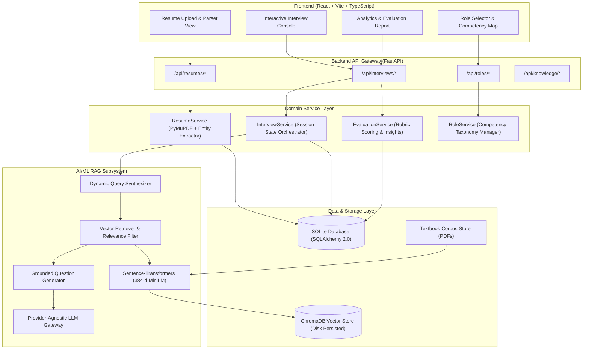
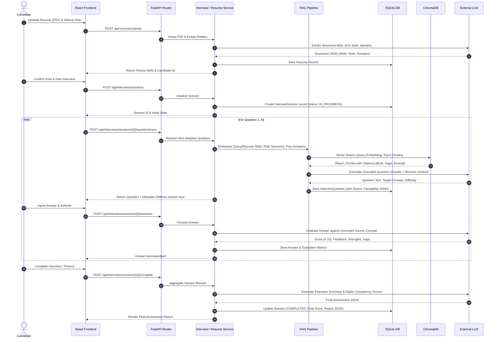

# System Architecture Specification

## Project: AI-Powered Role-Based Candidate Screening System

---

## 1. High-Level Architecture Overview

The system is architectured as a clean, modular, service-oriented application comprising:
1. **Presentation Layer (Frontend)**: A responsive Single Page Application (SPA) built with React, TypeScript, Vite, and Tailwind CSS.
2. **API & Service Layer (Backend)**: A high-performance Python application built on FastAPI, implementing strict dependency injection and service boundaries.
3. **AI/ML & RAG Engine**: A modular retrieval-augmented generation engine operating over curated textbook corpora using PyMuPDF, Sentence-Transformers, ChromaDB, and an external LLM API gateway.
4. **Data Persistence Layer**: SQLite managed via SQLAlchemy 2.0 ORM for transactional consistency, coupled with an on-disk ChromaDB persistent vector index.



---

## 2. End-to-End System Sequence & Data Flow

The following sequence details how candidate data, domain knowledge, and LLM reasoning interact across the full candidate lifecycle:



---

## 3. Component Breakdown & Responsibilities

### 3.1 Presentation Layer (`frontend/`)
- **Technology**: React 18 / 19, TypeScript, Vite, Tailwind CSS.
- **State Management**: React Context / Hooks (`InterviewContext`) managing the active candidate session, question step, timer, and cached feedback.
- **Key Modules**:
  - `ResumeDropzone`: Handles client-side validation (file size, PDF mime-type) and displays parsing progress.
  - `SkillTagList`: Interactive chips showing extracted candidate competencies.
  - `InterviewCard`: Clean, distraction-free questionnaire interface featuring:
    - Real-time response timer.
    - Grounding citation preview modal (displays which authoritative textbook topic is being tested).
    - Auto-saving draft answers.
  - `EvaluationSummaryView`: Radar chart visualization comparing candidate performance across Conceptual Accuracy, Practical Implementation, and Problem Solving.

### 3.2 API Layer (`backend/app/api/`)
- **Technology**: FastAPI with standard HTTP status codes, dependency injection, and Pydantic validation.
- **Responsibilities**:
  - Validates request payload schemas and file uploads.
  - Injects database sessions and service instances via `Depends()`.
  - Maps domain exceptions to standard HTTP error envelopes (`{ "error": true, "message": "...", "code": 404 }`).
  - Dispatches background tasks when appropriate.

### 3.3 Domain Service Layer (`backend/app/services/`)
- **`ResumeService`**:
  - Coordinates PDF text extraction via PyMuPDF.
  - Orchestrates structured NER and skill extraction through the LLM Gateway with schema validation.
- **`InterviewService`**:
  - Manages session lifecycle (`CREATED` -> `IN_PROGRESS` -> `COMPLETED` -> `ABANDONED`).
  - Controls question sequencing and enforces the maximum question quota (configurable, default 5 questions).
  - Coordinates with the RAG pipeline to generate context-grounded questions.
- **`EvaluationService`**:
  - Evaluates individual candidate responses against the source textbook context.
  - Computes running aggregates and generates final multi-dimensional assessment reports.
- **`RoleService`**:
  - Exposes configured role taxonomies (e.g., AI/ML Engineer, Data Scientist, Backend Engineer) and maps roles to textbook collection partitions in ChromaDB.

### 3.4 AI/ML & RAG Pipeline (`backend/app/rag/`)
- **`DocumentLoader` (`document_loader.py`)**:
  - Reads PDF textbooks using PyMuPDF (`fitz`), capturing page numbers, chapter headers, and text streams while filtering headers, footers, and indexes.
- **`Chunker` (`chunker.py`)**:
  - Implements recursive character text splitting with page awareness. Chunks are sized between 600 and 900 tokens with a 120-token overlap to maintain semantic continuity of technical formulations.
- **`Embedder` (`embedder.py`)**:
  - Encapsulates HuggingFace Sentence-Transformers (`all-MiniLM-L6-v2`), generating normalized dense vector representations.
- **`VectorStore` (`vector_store.py`)**:
  - Manages persistent ChromaDB collections. Supports query filtering by role domain and similarity metric optimization.
- **`QueryConstructor` (`query_constructor.py`)**:
  - Dynamically synthesizes search queries based on:
    1. Candidate's extracted resume skills.
    2. Selected target role competencies.
    3. Interview history (identifying untested domains or probing areas where the candidate previously showed weakness).
- **`Retriever` (`retriever.py`)**:
  - Performs vector similarity search with cosine distance filtering ($score \ge 0.60$). Implements diversity deduplication to prevent repeated topical questions.
- **`QuestionGenerator` (`question_generator.py`)**:
  - Enforces strict grounding prompts. Instructs the LLM to formulate an interview question based *only* on the retrieved textbook passage, connecting it naturally to a skill or project mentioned on the candidate's resume.
- **`LLMGateway` (`llm_gateway.py`)**:
  - Unified adapter supporting Groq (default `llama-3.3-70b-versatile` / `llama-3.1-8b-instant`), Google Gemini, and OpenAI-compatible providers. Includes retry backoff and token usage monitoring.

### 3.5 Persistence Layer (`backend/app/models/` & `data/`)
- **Relational Store**: SQLite database via SQLAlchemy 2.0 with foreign key constraints, automatic timestamps, and JSON column support for flexible metadata.
- **Vector Store**: ChromaDB running in persistent mode (`PersistentClient(path="./data/chroma_db")`).

---

## 4. Source Traceability & Grounding Protocol

To satisfy requirement **REQ-M5** and **REQ-M7** (traceability and academic grounding):
1. Every chunk ingested into ChromaDB is tagged with:
   ```json
   {
     "book_title": "The Hundred-Page Machine Learning Book",
     "author": "Andriy Burkov",
     "chapter": "Chapter 3: Fundamental Algorithms",
     "page_number": 42,
     "chunk_id": "burkov_ch3_p42_001"
   }
   ```
2. When a question is generated:
   - The top-k source chunks used in the prompt are serialized into the `InterviewQuestion.context_sources_json` column.
3. When the answer is evaluated:
   - The evaluator references both the candidate's answer and the exact textbook passage to verify conceptual accuracy.
4. In the final report:
   - The report UI displays clickable source cards indicating the exact book and chapter each question was derived from.

---

## 5. Non-Functional Attributes

1. **Local Reproducibility**:
   - The entire stack runs on a single local machine without cloud infrastructure dependencies (aside from the LLM inference API key).
   - Embeddings are generated locally using Sentence-Transformers without hitting external rate limits.
2. **Resilience & Graceful Degradation**:
   - If resume PDF parsing fails, the user is offered a plain text fallback.
   - If vector search yields low-confidence chunks, the query constructor automatically falls back to foundational core concepts from the role taxonomy.
3. **Clean Architecture**:
   - Zero business logic in FastAPI endpoint controllers.
   - Decoupled database entities and Pydantic DTOs.
