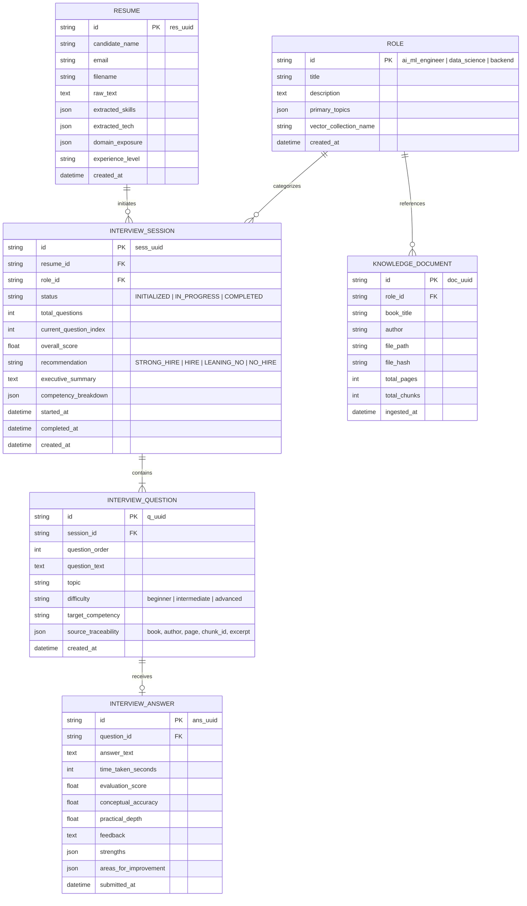

# Database Schema Specification

## Project: AI-Powered Role-Based Candidate Screening System
**Database Engine**: SQLite 3 (with SQLAlchemy 2.0 ORM)  
**Location**: `data/screening_system.db`

---

## 1. Entity-Relationship Diagram

---

## 2. Table Schemas & Column Specifications

### 2.1 `resumes`
Stores candidate profile information parsed from resumes (PDF or text).

| Column | Type | Constraints | Description |
|---|---|---|---|
| `id` | VARCHAR(36) | PRIMARY KEY | Unique ID (prefix `res_`) |
| `candidate_name` | VARCHAR(255) | NULLABLE | Extracted candidate name |
| `email` | VARCHAR(255) | NULLABLE | Extracted email address |
| `filename` | VARCHAR(255) | NOT NULL | Original filename or "text_input" |
| `raw_text` | TEXT | NOT NULL | Extracted text content from resume |
| `extracted_skills` | JSON | NOT NULL, DEFAULT '[]' | List of identified technical skills |
| `extracted_tech` | JSON | NOT NULL, DEFAULT '[]' | List of tools, libraries, and frameworks |
| `domain_exposure` | JSON | NOT NULL, DEFAULT '[]' | Industry or functional domains |
| `experience_level` | VARCHAR(50) | NULLABLE | Junior, Mid-Level, Senior |
| `created_at` | DATETIME | NOT NULL, DEFAULT UTC | Timestamp of record creation |

---

### 2.2 `roles`
Catalog of supported job roles and their associated competencies and vector collections.

| Column | Type | Constraints | Description |
|---|---|---|---|
| `id` | VARCHAR(64) | PRIMARY KEY | Identifier (e.g. `ai_ml_engineer`) |
| `title` | VARCHAR(255) | NOT NULL | Display name |
| `description` | TEXT | NOT NULL | Role summary |
| `primary_topics` | JSON | NOT NULL, DEFAULT '[]' | Evaluated topic clusters |
| `vector_collection_name`| VARCHAR(128) | NOT NULL | Target ChromaDB collection name |
| `created_at` | DATETIME | NOT NULL, DEFAULT UTC | Creation timestamp |

---

### 2.3 `interview_sessions`
Tracks the lifecycle, progress, and aggregated performance of an interview.

| Column | Type | Constraints | Description |
|---|---|---|---|
| `id` | VARCHAR(36) | PRIMARY KEY | Unique session ID (prefix `sess_`) |
| `resume_id` | VARCHAR(36) | NOT NULL, FK(`resumes.id`) | Associated candidate resume |
| `role_id` | VARCHAR(64) | NOT NULL, FK(`roles.id`) | Evaluated job role |
| `status` | VARCHAR(32) | NOT NULL, DEFAULT 'INITIALIZED' | `INITIALIZED`, `IN_PROGRESS`, `COMPLETED`, `ABANDONED` |
| `total_questions` | INTEGER | NOT NULL, DEFAULT 5 | Planned question count for session |
| `current_question_index`| INTEGER | NOT NULL, DEFAULT 0 | 0-indexed active question pointer |
| `overall_score` | FLOAT | NULLABLE | Final aggregated score (0.0 to 10.0) |
| `recommendation` | VARCHAR(32) | NULLABLE | Final hiring decision enum |
| `executive_summary` | TEXT | NULLABLE | LLM-generated assessment narrative |
| `competency_breakdown` | JSON | NULLABLE | Dimensional scores (accuracy, depth, etc.) |
| `started_at` | DATETIME | NULLABLE | When candidate begins Q1 |
| `completed_at` | DATETIME | NULLABLE | When interview finishes |
| `created_at` | DATETIME | NOT NULL, DEFAULT UTC | Creation timestamp |

---

### 2.4 `interview_questions`
Stores individual generated questions along with the source textbook chunk used for grounding.

| Column | Type | Constraints | Description |
|---|---|---|---|
| `id` | VARCHAR(36) | PRIMARY KEY | Unique ID (prefix `q_`) |
| `session_id` | VARCHAR(36) | NOT NULL, FK(`interview_sessions.id`) | Parent interview session |
| `question_order` | INTEGER | NOT NULL | 1-indexed order within session |
| `question_text` | TEXT | NOT NULL | The generated interview question |
| `topic` | VARCHAR(128) | NOT NULL | Subject topic (e.g., "Regularization") |
| `difficulty` | VARCHAR(32) | NOT NULL, DEFAULT 'intermediate' | `beginner`, `intermediate`, `advanced` |
| `target_competency` | TEXT | NULLABLE | Specific capability evaluated |
| `source_traceability` | JSON | NOT NULL | Book title, author, page, chunk_id, excerpt |
| `created_at` | DATETIME | NOT NULL, DEFAULT UTC | Generation timestamp |

---

### 2.5 `interview_answers`
Stores candidate responses and the evaluation generated by comparing against the source textbook context.

| Column | Type | Constraints | Description |
|---|---|---|---|
| `id` | VARCHAR(36) | PRIMARY KEY | Unique answer ID (prefix `ans_`) |
| `question_id` | VARCHAR(36) | NOT NULL, UNIQUE, FK(`interview_questions.id`) | Associated question |
| `answer_text` | TEXT | NOT NULL | Candidate's submitted answer text |
| `time_taken_seconds` | INTEGER | NOT NULL, DEFAULT 0 | Response duration |
| `evaluation_score` | FLOAT | NOT NULL | Composite evaluation score (0.0 - 10.0) |
| `conceptual_accuracy` | FLOAT | NOT NULL | Accuracy against textbook ground truth |
| `practical_depth` | FLOAT | NOT NULL | Applied understanding / trade-offs |
| `feedback` | TEXT | NOT NULL | Constructive qualitative feedback |
| `strengths` | JSON | NOT NULL, DEFAULT '[]' | Strengths demonstrated |
| `areas_for_improvement`| JSON | NOT NULL, DEFAULT '[]' | Specific knowledge gaps |
| `submitted_at` | DATETIME | NOT NULL, DEFAULT UTC | Submission timestamp |

---

### 2.6 `knowledge_documents`
Tracks textbook corpus files ingested into ChromaDB.

| Column | Type | Constraints | Description |
|---|---|---|---|
| `id` | VARCHAR(36) | PRIMARY KEY | Unique document ID (prefix `doc_`) |
| `role_id` | VARCHAR(64) | NOT NULL, FK(`roles.id`) | Role partition |
| `book_title` | VARCHAR(255) | NOT NULL | Book title |
| `author` | VARCHAR(255) | NOT NULL | Author(s) |
| `file_path` | VARCHAR(512) | NOT NULL | Local path to PDF |
| `file_hash` | VARCHAR(64) | NOT NULL | SHA-256 for change detection |
| `total_pages` | INTEGER | NOT NULL | Page count |
| `total_chunks` | INTEGER | NOT NULL | Number of vector chunks indexed |
| `ingested_at` | DATETIME | NOT NULL, DEFAULT UTC | Ingestion timestamp |

---

## 3. Database Indexes

To ensure snappy query performance under interactive session loads:
- `ix_interview_sessions_resume_id` on `interview_sessions(resume_id)`
- `ix_interview_questions_session_id` on `interview_questions(session_id)`
- `ix_interview_answers_question_id` on `interview_answers(question_id)`
- `ix_knowledge_documents_role_id` on `knowledge_documents(role_id)`

